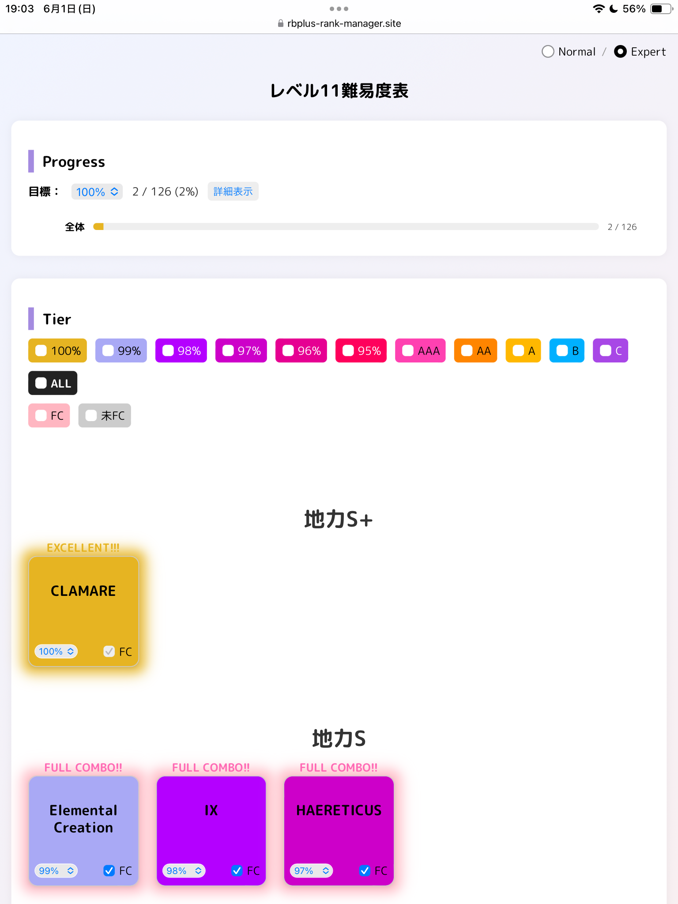
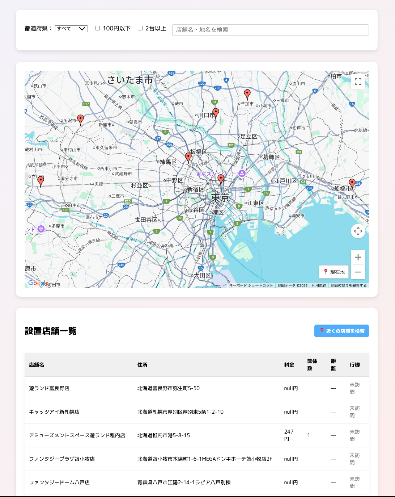
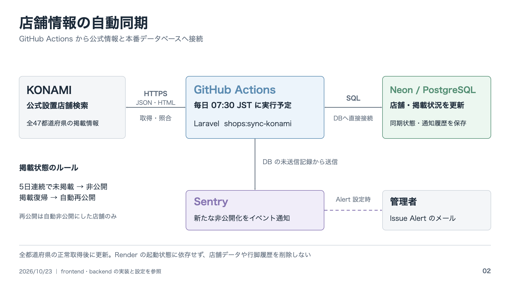
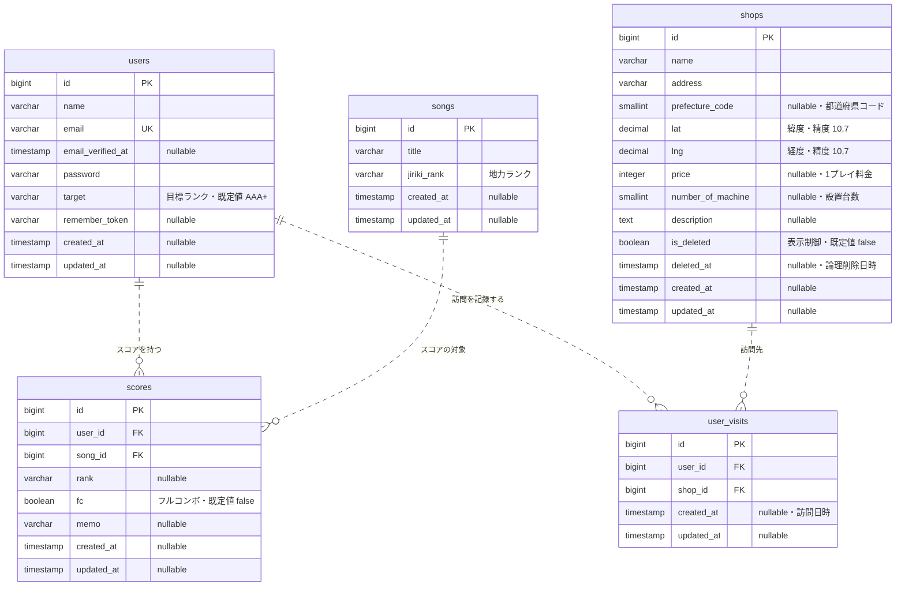

# 概要
**REFLEC BEAT plus Lv11 難易度表＆クリアランク管理サイト**
- **目的**：音楽ゲーム REFLEC BEAT plus のLv11のクリアランク・フルコンボ状況の管理を行う。
- **機能**：
  - Lv11の譜面を非公式に10段階に定義した「難易度表」を閲覧可能
  - 譜面ごとにクリアランク・フルコンボ状況を保存
  - Google Maps APIで店舗情報閲覧＆チェックイン機能
- **使用技術**：Vue 3 + TypeScript / Laravel 12 / PostgreSQL / Vercel + Render + Neon
- **URL**：[https://rbplus-rank-manager.site](https://rbplus-rank-manager.site)

- **画面イメージ**

## 背景
音楽ゲームの課題として、公式の同一レベル内でも譜面ごとに難易度差が大きいという点がある。 
そこで、音楽ゲームプレイヤーの間では、公式難易度を有志により細分化された非公式の「難易度表」が活用されることが多い。 
例えばKONAMIの人気音楽ゲーム「beatmania ⅡDX」は最高レベルは12であるが、Lv12の中でも難易度の差が激しく、有志によってLv12をさらに数段階に分ける試みがなされている。 
近年では、難易度表をWebアプリ化してクリアランクを管理する試みがなされている。 

※参考： 
- [12参考表(地力表)支援サイト](https://sp12.iidx.app)
- [CPI](https://cpi.makecir.com)
 
この難易度表の存在により、プレイヤーは実力に見合った適切な難易度の曲を選ぶことができる上、自分のプレイ進捗を可視化できる。 
 
一方、同じくKONAMIの音楽ゲーム「REFLEC BEAT」は「beatmania ⅡDX」と比べるとマイナーなゲームであり、このようなWebアプリがまだ存在していない。 
また、「REFLEC BEAT」も同様に、最高レベルのLv11の中でも難易度差が激しいという課題がある。 
そこで私は、「REFLEC BEAT」においても上記のような難易度表のWebアプリを作成し、プレイヤーのモチベーション維持に貢献するため開発に至った。

## URL
https://rbplus-rank-manager.site 

※検証用アカウント 
メールアドレス：test@example.com 
パスワード：password 

# 機能一覧
本アプリの機能は、メインの「難易度表閲覧・クリアランク管理」機能と、サブ要素として開発した「設置店舗閲覧・行脚」機能の2つに分かれる。
## 難易度表閲覧・スコア管理
### 非ログインユーザー向け
- 「REFLEC BEAT plus」収録のレベル11の全譜面について、地力ごとに分類したものを表示する（地力は非公式の10段階：地力F〜地力S+）
### ログインユーザー向け
- 各ユーザーは曲に対してランク（AAA+/AAA/...）、フルコンボの可否、メモを保存することができる
- 曲に対してランクをプルダウンで選択すると、曲のカードがランクに対応する色に変化する
- FC（フルコンボ）をチェックボックスで選択すると、曲のカードがFULL COMBO!!と表示される
- 超上級者向けの機能として、AAA+(95%)以上のランクを1%刻みで管理できる「Expertモード」を選択できる
- 99.0%以上を0.1%刻みで管理できる「Proモード」を選択できる（99.0%未満はまとめて表示）
- 表示モードはURLクエリ `mode=Normal` / `mode=Expert` / `mode=Pro` で管理し、再読込・URL共有でも維持される（未指定・不正値はNormal）
- Expert・Proモードで「100%」のランクを選択すると、曲のカードがEXCELLENT!!!と表示される
- フィルター機能があり、ランクとフルコンボ/未フルコンボで絞り込みができる
- 各ユーザーは目標ランクを設定することができ、目標に対する進捗状況をプログレスバーで視覚的に確認できる
- 「全体」プログレスバーは目標ランクの達成曲数／全曲数から達成率を計算し、対応ランクの色で表示される
- 「FC」プログレスバーはフルコンボ数／全曲数から達成率を計算し、ピンク色で表示される

## 設置店舗閲覧・行脚
### 非ログインユーザー向け
- アーケード版「REFLEC BEAT」の設置店舗を地図上で確認できる
- Google Maps上にピンが立っており、クリックすると店舗詳細を確認できる
- 詳細情報では1クレ料金、台数、メンテ状況、他音ゲー情報を確認できる
### ログインユーザー向け
- ユーザーは、訪問した店舗を位置情報によるチェックインで記録することができる（これを「行脚」という）
- 店舗に近づくと店舗一覧画面に「チェックインする」ボタンが表示される
- 訪れたことのある店舗を「行脚履歴」画面で確認することができる（表示項目は「都道府県」「店舗名」「訪問日時」）

## その他機能
- ユーザーは、アカウントの新規登録・ログイン・ログアウト・削除をすることができる
- お問い合わせフォームまたはGmail、公式Xから開発者への連絡や設置店舗の情報提供ができる

# 使用技術

| 分類          | 使用技術・サービス                                      |
|---------------|---------------------------------------------------------|
| フロントエンド | Vue 3, Vite, TypeScript, Pinia, Vue Router, Axios     |
| バックエンド   | Laravel 12, Laravel Breeze, Laravel Sanctum, Laravel Blade     |
| インフラ       | Vercel（フロントエンド）, Render（バックエンド ~~/DB~~）,  Neon(DB) ※2026/6/14~ |
| データベース   | SQLite（ローカル環境）, PostgreSQL（本番環境/Neon）         |
| デザイン       | Figma（画面設計）|
| その他         | Google Maps API, GitHub, ChatGPT, Codex |

# 構成図
## アーキテクチャ構成図

### アプリケーション構成

このアプリケーションは Vue 3 + Vite を用いたSPAとして構築されており、Laravel（Breeze + Sanctum）と連携したセキュアな認証処理を実装している。インフラはフロントをVercel、バックエンドをRender、DBをNeonにホストし、無料プランのスリープ対策としてGoogle Apps Scriptで定期的にアクセスを行う構成としている。

DNS管理はムームードメインで行い、ドメイン名 `rbplus-rank-manager.site` によって独自ドメインで運用している。

### 店舗情報の自動同期

Google Apps Script（GAS）が毎日07:00（日本時間）を指定してGitHub Actionsへ起動依頼する。通常は本実行と7時台の予備確認の計2回GASが動作し、店舗同期は1日1回行う。GitHubへの起動依頼に失敗した場合だけ7時台に再試行する。自動の起動依頼は07:00以上08:00未満に限り、実際の開始にはGASの遅延やGitHub runnerの待ち時間が加わる。

GitHub ActionsでLaravelの `shops:sync-konami` コマンドを実行し、KONAMI公式検索の全47都道府県を取得してNeonの店舗情報と照合する。全件を正常に取得した後、5日連続で未掲載の店舗を非公開にし、自動非公開にした店舗が復帰した場合は再公開する。新たな非公開化をSentry経由でメール通知する。Renderの起動状態には依存しない。

取得に失敗した場合は店舗情報を更新しない。起動依頼の受付後に同期処理が失敗した場合は、自動で再実行せず原因確認後に手動実行する。詳細は[バックエンドの運用説明](https://github.com/misato729/score-manager-backend#設置店舗の自動非公開化再公開)を参照。

## データベース構成（ER図）

本アプリの主要5テーブル（ユーザー・楽曲・スコア・設置店舗・訪問履歴）を、[バックエンドのマイグレーション](https://github.com/misato729/score-manager-backend/tree/main/database/migrations)に基づいて示す。認証トークン・セッション・キャッシュ・ジョブなどのLaravel用テーブルは省略している。

PKは主キー、FKは外部キー、UKは一意キーを表す。各関連は1対0件以上で、スコア・訪問履歴の外部キーには親レコード削除時の連鎖削除が設定されている。

# CI/CD
本プロジェクトは GitHub Actions + Vercel による CI/CD を導入している。
- **Lint / Typecheck / Unit Test**: ESLint, tsc, Vitest
- **Preview Deploy**: PR 作成時に Vercel の Preview 環境へ自動デプロイ  
- **E2E Test**: Preview URL に対して Playwright による E2E テストを実行  
  - Vercel の「Protection Bypass for Automation」を利用して GitHub Actions から Preview 環境にアクセス可能に設定
- **Production Deploy**: main ブランチへの push で Vercel 本番に自動デプロイ
